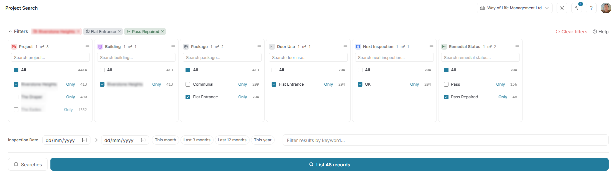
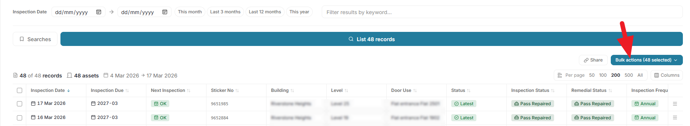
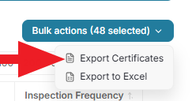
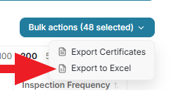

Start by choosing the filters. (See [Setting Filters](./setting-filters.md)). Make sure you have the documents you want to export selected.

Then click "List XX Reports"

This provides a list of the reports.

By default all are selected, but you select or unselect particular doors if preferred.

Then select "Bulk Actions"

::: {.panel-tabset}

### Exporting PDF Certificates and Reports

Select Export Certificates

Complete the options provided (if any), and click "Build".

### Exporting Excel Tables
Select Export to Excel

Choose the columns to include in the report (or leave the default for all available)

Click Export

:::