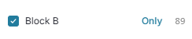
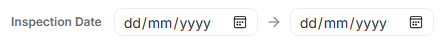
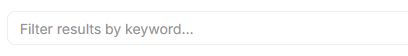

When you start, all records are included. Search for doors using the filters, which act like Excel table filters.

Check or uncheck the boxes to include or exclude. Clear or Select all with the **All** option. 

To select ONLY the item, click **Only**

{fig-alt="Only Button"}

You can also choose a date range below the filters. This filters on the date of the inspection or remedial.

{fig-alt="Date Filter Button"}

You can also experiment with free text searching. This is a good way to search by asset ID.

{fig-alt="Freetext Search Box"}

## What do filters mean?

::: {.panel-tabset}

### Common Filters

Project

Ace refers to a `Project` as a group of buildings that are usually treated together with a common management.

Building

Ace refers to a `Building` as a single building. Some projects only have 1 building.

Cost Designation

Cost Designation is the accountable cost center.

Package

There are two essential packages -- Flat Entrances and Communal doors.

- **Flat Entrance**: Responsibility of the Tenant. Flat Storage units (e.g. in car parks that are restricted to only the tenant are included)
- **Superseded**: Responsibility of the Managing Agent / Freeholder / Building Owner 

Inspection Due

The month in which the next inspection is due.

Next Inspection

Whether the inspection is Due, Overdue or OK.

- **Overdue**: The door is overdue for inspection
- **Due**: The door is due this month
- **OK**: The door is not due until earliest next month

Remedial Status

The status of the door.

- **No Access**: Ace has never known of an inspection
- **Not Firedoor**: The door has been inspected, but isn't a fire door
- **Pass**: The door was inspected and passed it's last inspection
- **Pass Repaired**: The door was remediated and passed
- **Pending**: The door [failed]{color="red"}
- **Pending Maintenance**: The door has failed, but it is under warranty and Ace will repair it.

### Optional Filters

Status

Whether this is the latest record or not. You can see golden thread records for each individial door when you click it.

- **Latest**: The current valid record.  
- **Superseded**: Old records that are not currently valid.  

Inspection Frequency

How often inspections are required.

- **Annual**: Annual inspection required by BS:8214, because it's a Flat Entrance, building lower than 11m or other reasons
- **Quarterly**: Quarterly inspection required by BS:8214 because it's a communal door or the build is over 11m.
- **Not Applicable**: The door is not subject to legally mandated inspections, usually because it is not a fire door.

Client

The name of the client that we record as the primary beneficiary of the inspection report.

Group

If your organisation has multiple groups, then you can filter by internal group.

:::

::: {.callout-tip collapse="true" appearance="simple"}

## Can't see a filter?

Most clients do not have all filters (especially Optional Filters), because they are not usually useful or don't apply. If you need access, [contact us](mailto:melinda.trufasu@aceconstructions.co.uk).
:::